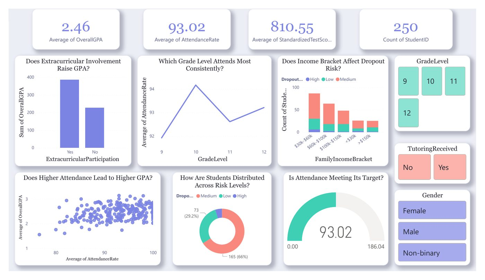

# Student Dropout Risk Dashboard

**Tool:** Power BI

Question-led dashboard on what drives GPA and dropout risk for 250 students, with slicers for grade level, tutoring and gender.

## Highlights
- 250 students, average GPA 2.46, average attendance 93.02
- Does extracurricular involvement raise GPA? Does income bracket affect dropout risk?
- Risk split: 66% medium, 29.2% low

## Files
- `DV_ASSIGNMENT.pdf`

Only the PDF export of the dashboard is included here.

## How to open
View `DV_ASSIGNMENT.pdf`.

---
By Faaz Mistry · [LinkedIn](https://www.linkedin.com/in/faaz-mistry-369a11246/) · faazmistry110@gmail.com
